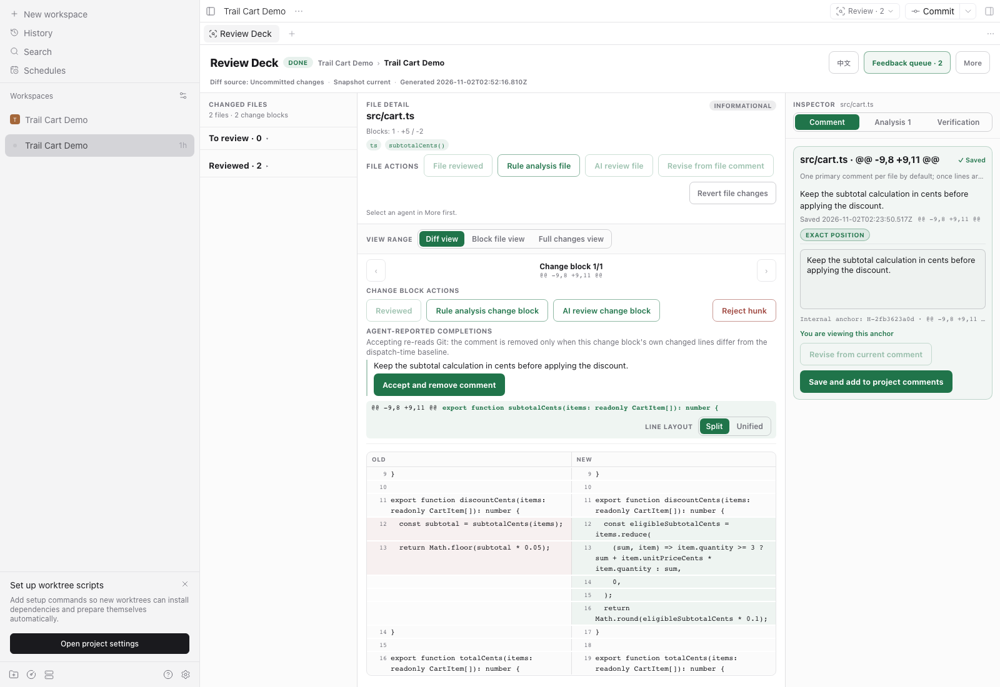
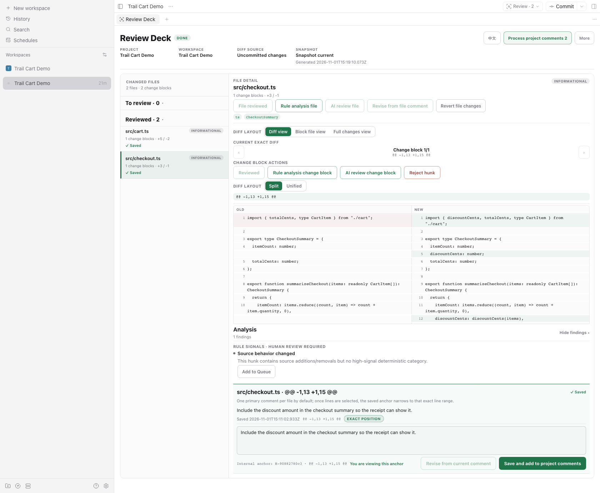
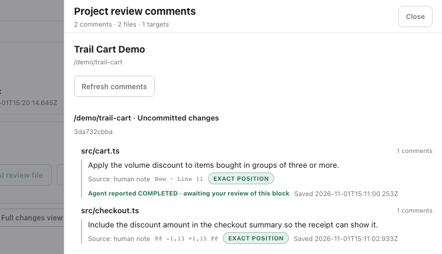
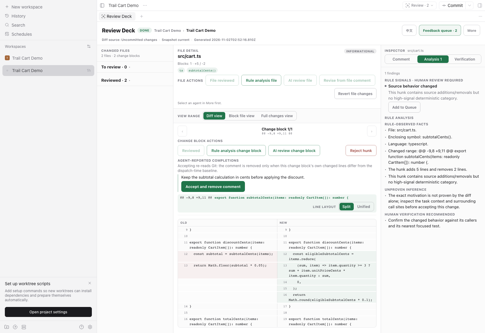
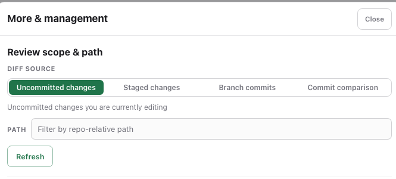
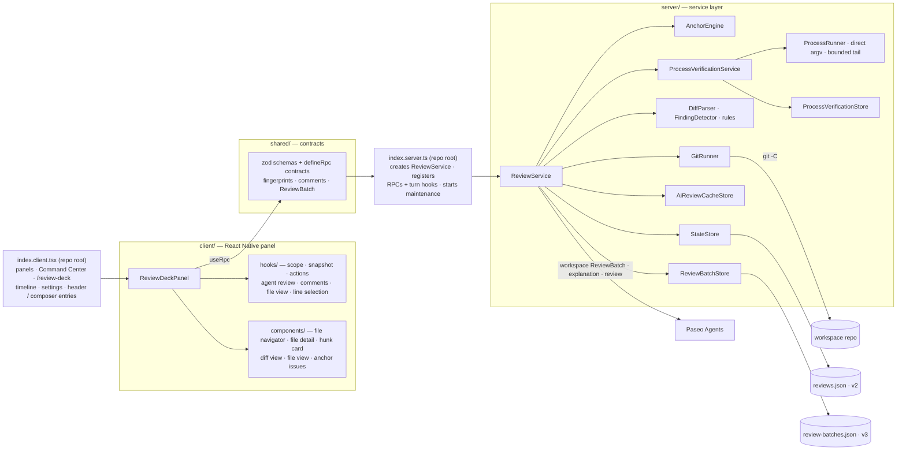

# Review Deck

**English** · [中文](README.zh-CN.md)

Review Deck helps you review a Paseo Agent's changes without losing context. Browse each file and Hunk, comment on exact lines, then send the project's comments to the Agent working in that workspace.



*An Agent's `COMPLETED` report is a prompt to review, not an automatic close.*

## Review from diff to decision

1. **Browse.** Compare changed files and Hunks with the old and new lines side by side.
2. **Comment.** Save a note on exact lines or on the whole Hunk.
3. **Send.** Collect project comments and send each workspace's group to its Agent.
4. **Re-read.** `COMPLETED` is the Agent's claim, not approval. Inspect the changed Hunk and accept it yourself before the comment leaves the queue.

Rule signals, AI findings, and command output help with the review; none replaces the human decision.

On desktop, keep the changed-file list, diff, and inspector in view. Short or compact screens switch to a file-by-file drill-down.

## See it in action



*Keep the file list and exact old/new lines in view while you write a comment.*



*Comments stay grouped by file. An Agent's `COMPLETED` report remains visible until you review the changed Hunk.*



*Rule analysis separates observed facts, unproven inference, and what a human should verify.*



*Review uncommitted or staged changes, branch commits, or a commit comparison; narrow the view by path.*

### More tools

- Review the working tree, staged changes, a branch, or selected commits.
- Run deterministic Rule checks or ask an Agent to explain a Hunk or review a file.
- Reject a Hunk only while its reviewed snapshot still matches; mark a whole file reviewed when appropriate.
- Follow batch and AI-review progress in stable Paseo timeline rows, and open Review Deck from the workspace Header, Command Center, `/review-deck`, or an Agent Composer Pill.
- Configure language, diff layout, reviewer model, depth preset, and token usage under host-scoped settings.
- Run a confirmed verification command in the workspace terminal, or open a configured Browser Preview.
- Use the interface in English or 中文.

<details>
<summary>Technical architecture and implementation details</summary>

## Architecture

Review Deck is a Paseo **0.10.0+** plugin using the v0.8 runtime-entry format: root `index.client.tsx` and `index.server.ts` entries sit above the React Native panel, typed RPC contracts, and server service layer.

Review state uses a versioned v2 envelope at `~/.paseo/review-deck/reviews.json`; ReviewBatch state uses a separate strict v3 envelope at `~/.paseo/review-deck/review-batches.json`.

A valid v1 or v2 ReviewBatch store migrates only after its exact bytes are preserved in a non-overwritable read-only `.v1.bak` / `.v2.bak`. Damaged data or conflicting backups fail closed, and migration never invents a dispatch-time baseline: old `COMPLETED` outcomes stay unaccepted until their comment is dispatched again.

Transient AI Review run metadata uses a strict v1 store at `~/.paseo/review-deck/runs.json`; it stores target/request identity only, never prompts, patches, or review text.

AI review cache uses a version-2 envelope with v1 byte-preserving migration, a 30-day TTL, and a 256-entry cap.

Captured process metadata lives in a separate strict v1 `process-verification-runs.json` store with a 30-day TTL and 256-run cap. Output is bounded and never persisted.

Git access is centralized behind one runner with fingerprint-checked safety.




- **index.client.tsx** is the Paseo 0.10 client runtime entry — it registers one workspace-scoped Review Deck tab, Command Center items, `/review-deck`, handoff / batch / AI-review timeline renderers, Review defaults, a workspace status popover, and subscription-backed Agent composer menus. Header, Agent, Queue, targeted-review, and timeline entry points reuse that tab.
- **index.server.ts** is the Paseo 0.10 server runtime entry — it retains the settings handle, constructs `ReviewService`, registers RPC and `agent.turn_started` / `agent.turn_ended` lifecycle handlers, and starts maintenance; cleanup removes both hooks and stops maintenance.
- **client/** owns presentation and intent only — every mutation goes through an RPC.
- **shared/review.ts** is the single source of truth for review RPC request/response shapes (zod), imported by both sides.
- **shared/review-batch.ts** defines ReviewBatch state and the strict `review-deck-batch` v1 timeline payload. The stable timeline item id replaces one row as status changes; the data includes only workspace ID, status, outcome counts, and timestamps.
- **shared/review-handoff.ts** retains the version-1 `review-deck-handoff` renderer for older timeline rows; its content-minimal payload records only a positive comment count and ISO submission timestamp.
- **shared/review-activity.ts** defines metadata-only workspace indicators, the on-demand working-tree summary, per-workspace read marking, and the strict `review-deck-ai-review` timeline payload. Badge refresh never parses Git; detailed block counts load only when the Header Popover opens.
- **`server/`** composes small, injectable classes: `GitRunner` wraps Git invocations with output limits and pins parsed diff headers to canonical `a/` and `b/` prefixes; `StateStore` validates and atomically migrates the v2 review envelope; `ReviewBatchStore` persists batch transitions in a strict versioned envelope; `DiffParser` provides the shared single-hunk body parser; `AnchorEngine` resolves anchors without auto-selecting ambiguity; and `ReviewService` orchestrates Git review and Agent batches.
- **Verification Terminal** opens an interactive workspace terminal after explicit confirmation. The user inspects output in Paseo; Review Deck does not infer command success or persist terminal output in v2.0.

- **Agent updates are event-driven.** One owned agent subscription feeds the panel registry and composer pills; workspace activity and agent updates trigger fingerprint-only snapshot checks, with a 60-second fallback.
- **Damaged review state fails closed.** Legacy files migrate automatically; invalid JSON or schema data surfaces an error and is never replaced with an empty store.

Requires **Paseo 0.10.0 or newer** (`>=0.10.0`).

</details>

## Usage

1. **Open the panel.** In a workspace Header, the **Review** button may be icon-only or inside the compact-layout overflow menu. A live Agent's Composer shows a **Review** Pill beside Tasks/Subagents. The Command Center and `/review-deck` also open it. These entry points reuse one Review Deck tab per workspace.
2. **Pick a project and workspace.** Use the pickers at the top of the panel. Selecting a project or workspace brings that workspace to the Paseo foreground.
3. **Browse and select the change.** Work through the changed files; each file shows its hunks with the exact diff next to the change details. Click a line number to select it; Shift-click extends a range on desktop, while compact layouts use two taps.
4. **Leave a comment.** Save a comment against the selected line range, or leave the selection empty to keep the hunk-level anchor.
5. **Watch the queue.** The project comments queue at the top summarizes all saved comments for the current project.
6. **Submit workspace batches.** The queue groups comments by workspace. An Agent-launched Review Deck preselects that Agent; otherwise one freshly verified idle Agent bound to the exact workspace is selected. Running or initializing Agents remain visible but cannot receive comment batches. Workspaces without an eligible Agent stay queued.
7. **Track outcomes and delivery.** The matching Agent turn records one outcome per comment, and the queue shows it. A `COMPLETED` outcome never removes the comment by itself: the reviewer opens the change block that was fixed, and **Accept and remove comment** asks the server to re-read Git. The comment is deleted only when the newest owning batch reported `COMPLETED`, the visible target and hunk still match exactly, and the block's own changed lines differ from the dispatch-time baseline recorded during preflight. An unchanged block, an unrelated hunk, an edited or replaced comment, or a superseded batch all fail closed and keep the comment queued. Each send has a stable message id; an ambiguous send remains claimed and is never retried automatically. A confirmed duplicate-risk action can release a stranded claim for a user-confirmed retry.
8. **Tune the defaults.** Under **Settings → Plugins → Review defaults**, choose the panel language (Auto / 中文 / English) and the default diff layout (Auto / Unified / Split); these host-scoped settings apply everywhere Review Deck opens.
9. **Run a verification command.** Review the structured executable and arguments, then confirm. Review Deck opens an interactive terminal in the current workspace; inspect its output in Paseo. v2.0 does not mark pass/fail automatically.
10. **Preview the project.** On Electron, open **More → Browser Preview**, set the project's HTTP(S) URL, then choose **Open Preview**. The URL is saved per project on the current Host.

## Limitations

- **Unfinished comments remain queued.** A comment leaves the queue only through an explicit human acceptance of an Agent-reported `COMPLETED` outcome; the outcome itself never deletes anything. Missing, malformed, duplicate, conflicting, stale, ambiguous, or mismatched-turn outcomes remain pending, and so does every `COMPLETED` outcome until a human accepts it on the visible change block. Acceptance requires the newest owning batch for that comment, an exact match of the visible target and hunk to a fresh snapshot, the same project/workspace/scope/file (rename alias included), the baseline's old-side window, and a current path-independent changed-lines identity (`changedLinesId`) different from the dispatch-time baseline, so a pure rename never counts as an edit. Batches written before version 3 carry no baseline, so their old `COMPLETED` outcomes cannot be accepted until the comment is dispatched again; comments already deleted by older builds cannot be recovered. Review Deck persists a send intent and stable message id before dispatch. A successful `send()` acknowledgment or exact timeline message proves delivery, not completion. The SDK exposes no stable rejection discriminator, so every `send()` failure is conservatively treated as unknown and never retried automatically. Timeline evidence can recover delivery; `unknown` or `accepted` batches without a proven Turn retain their claims across restarts. Active v1 batches without delivery identity are never auto-linked, failed, or released by Turn/Archive events; explicit release is required and may duplicate work. Only a prepared batch with no persisted send attempt gets a two-minute grace, released after a successful refresh shows the Agent is not running or initializing. A proven Turn can be released as unresolved after it stops; Archive events resolve only new batches whose delivery state proves they are not in flight. Status/timeline lookup failure or a null Agent snapshot keeps the claim. The Agent's claim is not independent verification, so review the resulting diff before accepting it.
- **AI Review recovery is bounded.** After reload, a running review resumes only when its labeled child still matches the stored parent/workspace and is not archived. Runs past the one-hour metadata TTL, missing children, archived children, or prompt/schema-version mismatches are abandoned. The UI's active poll loop has a separate five-minute wait cap. `runs.json` stores metadata only; review content stays in the Agent timeline or optional cache.
- **Workspace routing is fail-closed.** A batch is bound to one workspace and one Agent in that workspace. Legacy comments without `workspaceId` are assigned only when a complete project workspace list proves their cwd has exactly one owner; ambiguous or unavailable ownership leaves them unassigned. If no eligible Agent exists, Review Deck keeps comments queued and never creates an Agent automatically.
- **Timeline rows are status records, not review content.** Batch rows update by stable id; AI-review rows report status, finding/high-risk counts, and usage. Neither timeline payload includes comment ids, text, paths, cwd, patches, or full findings.
- **Commit scopes are read-only.** Branch and commit scopes support commenting and feedback, but hunk rejection is available only for working-tree and staged changes.
- **Agent availability depends on workspace.** Project batches need an eligible Agent in each target workspace; AI review and explain still use an Agent in the current workspace. Without a batch Agent, comments stay queued, while deterministic analysis and manual review remain available.
- **Notifications are in-app only.** v1.7 uses Header/Pill badges, popovers, and Agent timeline summaries; Paseo exposes no generic plugin-generated OS push-notification API.
- **Unread AI findings follow the one-hour run TTL.** Completed file/target finding counts stay unread across reloads until Review Deck opens for that workspace or the transient ReviewRun metadata expires. Opening Review Deck through the Queue action does not mark findings read.
- **Verification commands require structured output and confirmation.** A prose `suggestedCheck` has no Run action. Commands run in a workspace-owned terminal; output stays in Paseo, and v2.0 does not create `verified_fact` from a command. Automatic exit-status evidence is deferred to v2.1.
- **Browser Preview requires Electron.** The URL is host-scoped per project. Other clients hide the action; there is no external-browser fallback.
- **One Review Deck tab per workspace.** Header, Agent, Queue, targeted-review, and timeline actions reuse one workspace panel. Tabs persisted under old Agent, Queue, or targeted-review panel IDs may remain unavailable after updating; close them once manually. Paseo exposes no plugin API to close restored panel tabs.
- **Cross-host Review Inbox is deferred to v2.1.** The current Paseo SDK cannot invoke Review Deck's plugin RPC on another Host, so v2.0 does not aggregate cross-host comment status.

## Safety controls

- **Fingerprint-checked Git operations.** Hunk rejection applies a reverse patch only after verifying that the workspace and index still match the reviewed snapshot. If anything changed, the operation is safely refused and the analysis is marked stale.
- **Re-anchoring and batch preflight are fail-closed.** Unique exact/content/context matches may follow comments; stale or ambiguous anchors are never guessed. Before submission, Review Deck snapshots the current target and resolves every selected comment through the AnchorEngine; a changed selection, stale/ambiguous anchor, or workspace identity fails the whole batch. Unique relocations update only the prompt payload. The Agent must still verify the current fingerprint before editing because Git can change after preflight. Reject/revert independently verify current target and hunk fingerprints.
- **ReviewBatch downgrade safety.** The v3 store preserves a v1 or v2 backup at `~/.paseo/review-deck/review-batches.json.v1.bak` / `.v2.bak`. Stop the plugin before restoring this backup over `review-batches.json` to downgrade; do not copy a legacy backup over a store that has since accepted new batches. A restored v2 store keeps its outcomes but has no baselines, so no acceptance can be recorded until the comment is dispatched again; comments already deleted by an older build cannot be recovered.

## Installation

Review Deck requires Paseo 0.10.0 or newer (`>=0.10.0`). Installing from npm requires Paseo 0.11.0 or newer.

Install the published npm package:

```sh
paseo plugin install npm:@mentalfl0w/review-deck@2.2.0
paseo plugin ls
```

To install directly from GitHub instead:

```sh
paseo plugin install git:https://github.com/mentalfl0w/review-deck.git
```

Open the panel from the Command Center (**⌘K** on macOS, **Ctrl+K** on Windows/Linux) with **Open Review Deck** — or, from inside an Agent, use **Open Review Deck for this Agent** or the **`/review-deck`** slash command for the Agent-bound deck.

The plugin depends on an existing Paseo workspace and Agent. No additional model configuration is required — models are configured in the Paseo Agent settings, and Review Deck uses the model of the Agent you select.

## Development

From the repository root:

```sh
npm install
npm run typecheck
npm test
```

Create a disposable Git project for manual UI smoke tests:

```sh
DEMO_PATH="$(node scripts/create-review-deck-demo.mjs)"
paseo project create "$DEMO_PATH"
paseo workspace create --isolation local --path "$DEMO_PATH" --title "Trail Cart Demo"
```

The fixture has a committed baseline and two changed files. After the smoke test, delete the project from Paseo (this archives its workspaces but leaves files on disk), then remove only the directory printed by the script.

Install and manage a local checkout with the Paseo CLI:

```sh
paseo plugin install /absolute/path/to/review-deck
paseo plugin reload review-deck
paseo plugin ls
```
Git-based installs compile client source in a fresh checkout, without the development dependencies installed by the commands above. Client code should use Paseo-provided types from `@getpaseo/plugin/client`; direct type imports from `@getpaseo/client` or `@getpaseo/protocol` may not resolve during installation.

## Acknowledge

Review Deck relies on the Paseo Plugin API and is designed to complement the Paseo workspace and agent workflow. Thanks to the Paseo team for the plugin system, workspace, and agent model that make human-in-the-loop review possible.
