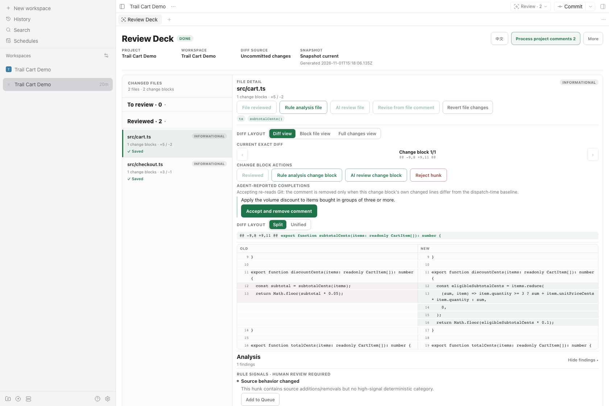
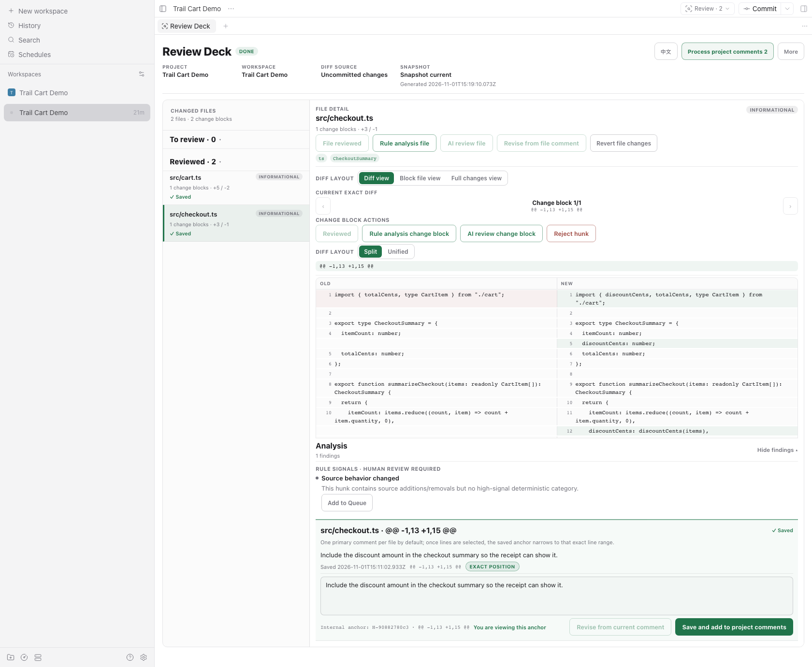
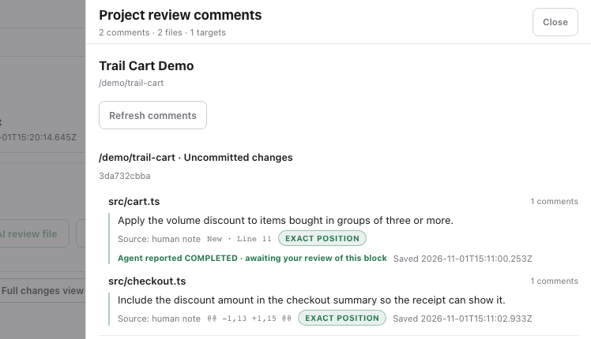
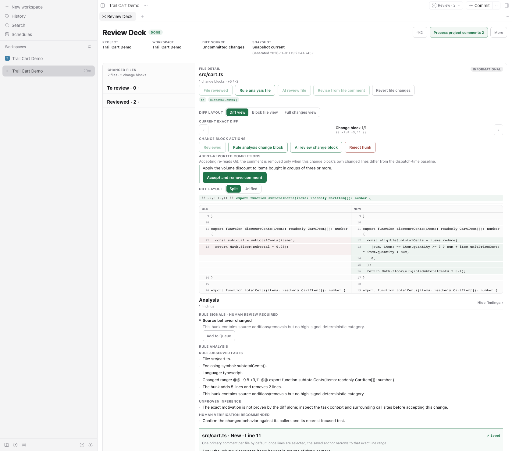
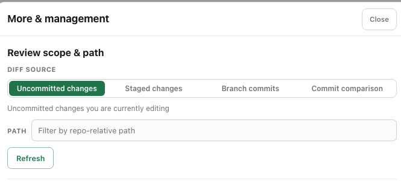
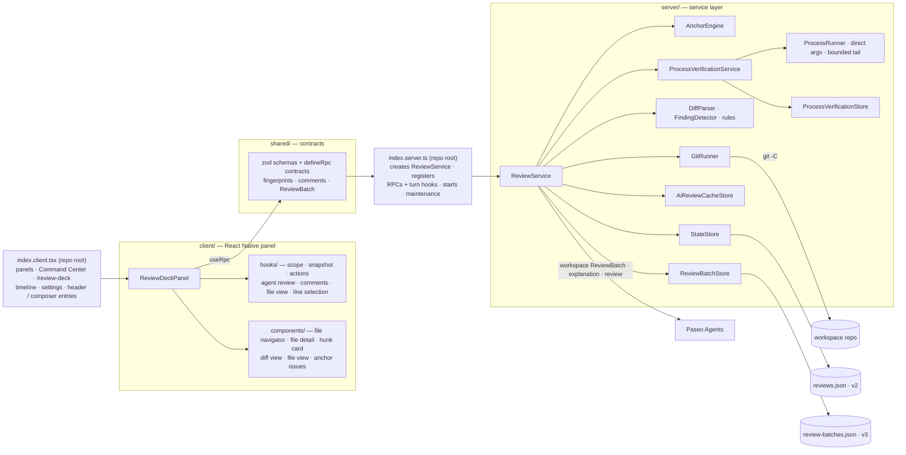

# Review Deck

[English](README.md) · **中文**

Review Deck 是一个面向 Paseo 的人机协同代码审阅插件。Agent 在 Paseo workspace（worktree）里改完代码后，你可以按文件和 Hunk 浏览变更，在具体行上写评论，再把当前项目的评论按 workspace 批量发给对应的 Agent。



*Agent 报告 `COMPLETED` 只表示可以复核，不会自动关闭评论。*

## 从 diff 到决定

1. **浏览。** 按文件和 Hunk 查看改动，新旧行并排对照。
2. **评论。** 可以评论选中的行，也可以评论整个 Hunk。
3. **发送。** 收集项目评论，按 workspace 分组发送给对应的 Agent。
4. **复核。** `COMPLETED` 只是 Agent 的说法，不是批准。打开改动后的 Hunk 自己确认，评论才会离开队列。

Rule signals、AI findings 和命令输出都只是辅助，最终由人决定。

桌面端使用左右双栏；窄屏按文件逐级进入。

## 实际界面



*文件列表和准确的新旧行始终在旁边，写评论时不用来回切页面。*



*评论按文件分组。Agent 报告 `COMPLETED` 后，在人工复核改动 Hunk 之前，评论仍留在队列里。*



*Rule 分析会把观察到的事实、尚未证实的推断和需要人工确认的内容分开显示。*



*可以审阅未提交、已暂存的改动、分支提交或提交对比，也可以按路径筛选。*

### 更多能力

- 审阅工作区、暂存区、分支或指定提交。
- 运行确定性的 Rule 检查，或让 Agent 解释 Hunk、审阅整个文件。
- 只在审阅快照仍然匹配时拒绝 Hunk；也可以把整个文件标记为已审阅。
- 在 Paseo 时间线中跟踪批次和 AI review 进度；从 workspace Header、Command Center、`/review-deck` 或 Agent Composer Pill 打开 Review Deck。
- 在 host 级设置里配置语言、diff 布局、reviewer 模型、审阅深度和 token 用量。
- 在工作区终端里运行确认过的验证命令，或打开配置好的 Browser Preview。
- 界面支持英文和中文。

<details>
<summary>技术架构与实现细节</summary>

## 架构

Review Deck 是 Paseo **0.10.0+** 插件，使用 v0.8 runtime-entry 结构：根目录的 `index.client.tsx` 和 `index.server.ts` 位于 React Native 面板、带类型的 RPC 契约和服务层之上。

审阅状态保存在 `~/.paseo/review-deck/reviews.json` 的 v2 信封中；ReviewBatch 状态保存在独立的严格 v3 信封 `~/.paseo/review-deck/review-batches.json` 中。

v1 或 v2 的 ReviewBatch 存储只有在原始字节被完整保存到不可覆盖的只读 `.v1.bak` / `.v2.bak` 之后才会迁移。数据损坏或备份冲突会直接失败；迁移不会虚构派发时的基准，旧 `COMPLETED` 结果在评论重新派发前不能用于接受。

临时 AI Review 运行元数据使用 `~/.paseo/review-deck/runs.json` 的严格 v1 存储，只保存 target/request 身份，不保存 prompt、patch 或审阅文本。

AI review 缓存使用 v2 信封，支持 v1 字节保留迁移、30 天 TTL 和 256 条上限。

捕获式验证的元数据存放在独立的严格 v1 `process-verification-runs.json` 中，TTL 为 30 天，最多 256 条；输出有界且不会持久化。

所有 Git 访问都经过同一个 runner，并做指纹校验。



- **index.client.tsx** 是 Paseo 0.10 的客户端 runtime entry：注册一个 workspace 级 Review Deck 标签页、Command Center 项、`/review-deck`、handoff / batch / AI-review 时间线渲染器、Review defaults、workspace 状态 popover，以及由订阅驱动的 Agent Composer 菜单。Header、Agent、Queue、targeted-review 和时间线入口都复用这个标签页。
- **index.server.ts** 是 Paseo 0.10 的服务端 runtime entry：保留 settings handle，构造 `ReviewService`，注册 RPC 和 `agent.turn_started` / `agent.turn_ended` 生命周期处理器，并启动维护任务；清理时移除 hook 并停止维护。
- **client/** 只负责展示和意图，所有修改都通过 RPC 完成。
- **shared/review.ts** 是审阅 RPC 请求/响应结构（zod）的唯一来源，前后端共用。
- **shared/review-batch.ts** 定义 ReviewBatch 状态和严格的 `review-deck-batch` v1 时间线载荷。时间线条目用稳定 id 原地替换；数据只包含 workspace ID、状态、结果计数和时间戳。
- **shared/review-handoff.ts** 保留旧时间线行的 version-1 `review-deck-handoff` 渲染器；载荷只记录正数评论数和 ISO 提交时间。
- **shared/review-activity.ts** 定义只含元数据的 workspace 指示器、按需加载的工作区摘要、按 workspace 标记已读，以及严格的 `review-deck-ai-review` 时间线载荷。徽标刷新不解析 Git；详细块数只在打开 Header Popover 时加载。
- **`server/`** 由小型可注入类组成：`GitRunner` 限制 Git 输出并固定 diff header 的 `a/`、`b/` 前缀；`StateStore` 校验并原子迁移 v2 审阅信封；`ReviewBatchStore` 以严格版本化信封持久化批次状态；`DiffParser` 提供共享的单 Hunk body 解析；`AnchorEngine` 解析锚点但不会自动选择歧义；`ReviewService` 编排 Git 审阅和 Agent 批次。
- **Verification Terminal** 在显式确认后打开工作区终端。用户在 Paseo 中查看输出；v2.0 不会推断命令成功，也不会持久化终端输出。

- **Agent 更新由事件驱动。** 一个自有 agent 订阅同时供面板注册表和 composer pills 使用；workspace 活动和 agent 更新触发只读指纹的 snapshot 检查，另有 60 秒兜底。
- **审阅状态损坏时失败关闭。** 旧文件会自动迁移；无效 JSON 或 schema 数据会报错，不会用空存储覆盖。

需要 **Paseo 0.10.0 或更高版本**（`>=0.10.0`）。

</details>

## 使用

1. **打开面板。** 在 workspace Header 中，**Review** 按钮可能是图标，也可能在紧凑布局的溢出菜单里。活跃 Agent 的 Composer 会在 Tasks/Subagents 旁显示 **Review** Pill。Command Center 和 `/review-deck` 也能打开。这些入口复用同一个 workspace 级 Review Deck 标签页。
2. **选择项目和 workspace。** 用面板顶部的选择器。选中项目或 workspace 会把对应 workspace 切到 Paseo 前台。
3. **浏览并选择改动。** 逐个查看改动文件；每个文件会显示 Hunk 和旁边的准确 diff。桌面端点行号选择单行，Shift-click 扩展范围；紧凑布局用两次点击。
4. **写评论。** 可以针对选中的行范围保存评论；不选行时评论锚定整个 Hunk。
5. **查看队列。** 顶部的项目评论队列汇总当前项目的所有已保存评论。
6. **按 workspace 提交批次。** 队列按 workspace 分组。从 Agent 打开的 Review Deck 会预选该 Agent；否则需要选择一个刚校验过、处于 idle 且绑定到准确 workspace 的 Agent。运行中或初始化中的 Agent 仍然可见，但不能接收评论批次。没有可用 Agent 的 workspace 会继续排队。
7. **跟踪结果和送达。** 匹配的 Agent turn 会为每条评论记录结果，队列会显示出来。`COMPLETED` 不会自己删除评论：审阅者打开被修复的改动块，点 **Accept and remove comment**，服务器会重新读取 Git。只有最新拥有该评论的批次报告了 `COMPLETED`、可见 target 和 Hunk 仍然精确匹配、并且该块自身的改动行与 preflight 记录的派发基准不同，评论才会被删除。未改动的块、不相关的 Hunk、被编辑或替换的评论、被新批次接管的评论都会失败关闭，继续留在队列。每次发送有稳定的 message id；送达状态不明确的发送会保留占用，不会自动重试。确认重复风险后，可以释放卡住的占用并手动重试。
8. **调整默认值。** 在 **Settings → Plugins → Review defaults** 中选择面板语言（Auto / 中文 / English）和默认 diff 布局（Auto / Unified / Split）；这些 host 级设置对所有 Review Deck 窗口生效。
9. **运行验证命令。** 检查结构化 executable 和参数后确认。Review Deck 会在当前 workspace 打开交互式终端；输出由你在 Paseo 中查看，v2.0 不会自动标记通过或失败。
10. **预览项目。** 在 Electron 上打开 **More → Browser Preview**，设置项目的 HTTP(S) 地址，然后选择 **Open Preview**。URL 按项目和当前 Host 保存。

## 限制

- **未完成的评论会留在队列。** 评论只有在人工明确接受 Agent 报告的 `COMPLETED` 后才会离开队列；`COMPLETED` 本身不删除任何东西。缺失、格式错误、重复、冲突、过期、歧义或 turn 不匹配的结果都会保持待处理；每条 `COMPLETED` 结果也要等人工在可见改动块上接受。接受要求：该评论由最新拥有它的批次管理；可见 target 和 Hunk 与最新快照精确匹配；project/workspace/scope/file 一致（包含重命名别名）；命中基线的 old-side 窗口；当前与路径无关的改动行身份（`changedLinesId`）与派发基准不同。因此纯重命名不算修改。v3 之前的批次没有基准，旧 `COMPLETED` 结果必须重新派发后才能接受；更早版本已删除的评论无法恢复。Review Deck 在发送前持久化发送意图和稳定 message id。`send()` 成功或时间线中出现精确消息只能证明送达，不能证明完成。SDK 没有稳定的拒绝判别，因此所有 `send()` 失败都按未知处理，不会自动重试。时间线证据可以恢复送达状态；没有已证明 Turn 的 `unknown` 或 `accepted` 批次会跨重启保留占用。没有 delivery identity 的旧 v1 活跃批次不会被 Turn/Archive 事件自动关联、判定失败或释放；需要显式释放，可能造成重复操作。只有没有持久化发送尝试的 prepared 批次有两分钟宽限，在成功刷新确认 Agent 不在运行或初始化后才释放。已证明的 Turn 停止后可以按 unresolved 释放；Archive 事件只会处理送达状态证明未在途的新批次。状态/时间线查询失败或 Agent 快照为空时保留占用。Agent 的声明不是独立验证，接受前请检查实际 diff。
- **AI Review 恢复有边界。** 重载后，运行中的审阅只有在带标签的子 Agent 仍匹配保存的 parent/workspace 且未归档时才会恢复。超过一小时元数据 TTL、子 Agent 丢失、已归档或 prompt/schema 版本不匹配的运行会被放弃。UI 的主动轮询另有五分钟上限。`runs.json` 只存元数据；审阅内容留在 Agent 时间线或可选缓存中。
- **Workspace 路由失败关闭。** 一个批次只绑定一个 workspace 和该 workspace 中的一个 Agent。没有 `workspaceId` 的旧评论，只有在完整项目 workspace 列表证明其 cwd 只有一个所有者时才会分配；所有权有歧义或无法取得时保持未分配。没有可用 Agent 时，Review Deck 会保留评论，不会自动创建 Agent。
- **时间线行是状态记录，不是审阅内容。** 批次行按稳定 id 更新；AI-review 行报告状态、finding/高风险数量和用量。两种载荷都不包含评论 id、文本、路径、cwd、patch 或完整 findings。
- **提交范围是只读的。** 分支和提交范围支持评论与反馈，但只有工作区和暂存区支持拒绝 Hunk。
- **Agent 可用性取决于 workspace。** 项目批次需要每个目标 workspace 中有可用 Agent；AI review 和 explain 仍使用当前 workspace 的 Agent。没有批次 Agent 时评论继续排队，确定性分析和手动审阅仍然可用。
- **通知只在应用内。** v1.7 使用 Header/Pill 徽标、popover 和 Agent 时间线摘要；Paseo 没有提供通用的插件 OS 推送 API。
- **未读 AI findings 跟随一小时运行 TTL。** 完成的 file/target finding 计数在重载后仍为未读，直到打开该 workspace 的 Review Deck 或临时 ReviewRun 元数据过期。通过 Queue 动作打开 Review Deck 不会把 findings 标为已读。
- **验证命令需要结构化输出和确认。** 散文式的 `suggestedCheck` 没有 Run 动作。命令在 workspace 所有的终端中运行；输出留在 Paseo 中，v2.0 不会根据命令创建 `verified_fact`。自动退出状态证据推迟到 v2.1。
- **Browser Preview 需要 Electron。** URL 按项目和 Host 保存。其他客户端会隐藏该动作，也没有外部浏览器兜底。
- **每个 workspace 只有一个 Review Deck 标签页。** Header、Agent、Queue、targeted-review 和时间线动作都复用同一个 workspace 面板。更新后，旧 Agent、Queue 或 targeted-review panel ID 下持久化的标签页可能不可用；手动关闭一次即可。Paseo 没有提供关闭已恢复 panel 标签页的插件 API。
- **跨 Host Review Inbox 推迟到 v2.1。** 当前 Paseo SDK 无法在另一个 Host 上调用 Review Deck 的插件 RPC，所以 v2.0 不聚合跨 host 的评论状态。

## 安全控制

- **Git 操作有指纹校验。** 拒绝 Hunk 只有在 workspace 和索引仍匹配审阅快照时才会应用反向 patch。否则会安全拒绝，并把分析标记为过期。
- **重新锚定和批次 preflight 失败关闭。** 唯一的 exact/content/context 匹配可以跟随评论；过期或歧义锚点绝不会猜测。提交前，Review Deck 会快照当前 target，并用 AnchorEngine 解析每条选中的评论；选择变化、锚点过期/歧义或 workspace 身份不一致都会让整个批次失败。只有唯一重定位会更新 prompt 内容。Agent 仍必须在编辑前自行校验当前指纹，因为 preflight 后 Git 仍可能变化。Reject/revert 会独立校验当前 target 和 Hunk 指纹。
- **ReviewBatch 降级安全。** v3 存储会在 `~/.paseo/review-deck/review-batches.json.v1.bak` / `.v2.bak` 保存 v1 或 v2 备份。降级时先停止插件，再用备份覆盖 `review-batches.json`；不要用旧备份覆盖已经接受过新批次的存储。恢复后的 v2 存储保留结果但没有 baseline，评论必须重新派发后才能接受；旧版本已经删除的评论无法恢复。

## 安装

Review Deck 需要 Paseo 0.10.0 或更高版本（`>=0.10.0`）。从 npm 安装需要 Paseo 0.11.0 或更高版本。

安装已发布的 npm 包：

```sh
paseo plugin install npm:@mentalfl0w/review-deck@2.1.1
paseo plugin ls
```

也可以直接从 GitHub 安装：

```sh
paseo plugin install git:https://github.com/mentalfl0w/review-deck.git
```

用 Command Center（macOS 的 **⌘K**，Windows/Linux 的 **Ctrl+K**）打开 **Open Review Deck**；或者在 Agent 内使用 **Open Review Deck for this Agent** 或 **`/review-deck`** 打开绑定该 Agent 的 deck。

插件依赖已有的 Paseo workspace 和 Agent。不需要额外模型配置；模型在 Paseo 的 Agent 设置中配置，Review Deck 使用你选择的 Agent 的模型。

## 开发

在仓库根目录：

```sh
npm install
npm run typecheck
npm test
```

创建一个可丢弃的 Git 项目，用于手动 UI 冒烟测试：

```sh
DEMO_PATH="$(node scripts/create-review-deck-demo.mjs)"
paseo project create "$DEMO_PATH"
paseo workspace create --isolation local --path "$DEMO_PATH" --title "Trail Cart Demo"
```

夹具包含一个已提交基线和两个已修改文件。测试结束后，从 Paseo 删除项目（会归档 workspace，但保留磁盘文件），再删除脚本打印的临时目录。

安装和管理本地 checkout：

```sh
paseo plugin install /absolute/path/to/review-deck
paseo plugin reload review-deck
paseo plugin ls
```

从 Git 安装时，会在全新 checkout 中编译客户端源码，但没有上面命令安装的开发依赖。客户端代码应使用 `@getpaseo/plugin/client` 提供的类型；直接类型导入 `@getpaseo/client` 或 `@getpaseo/protocol` 在安装时可能无法解析。

## 致谢

Review Deck 依赖 Paseo Plugin API，并与 Paseo 的 workspace 和 Agent 工作流配合。感谢 Paseo 团队提供的插件系统、workspace 和 Agent 模型，让人机协同审阅可以落地。
